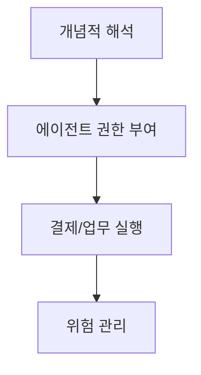
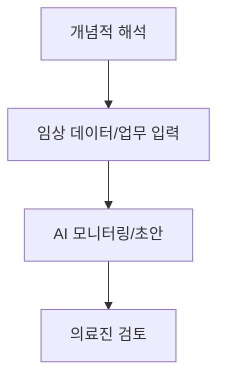
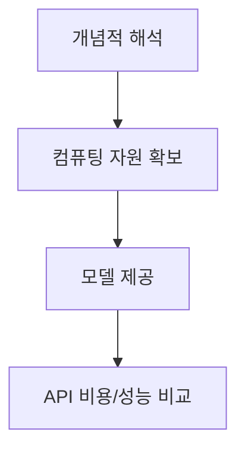

# Daily Report / 2026-10-27

> AI Agent / Agentic AI / LLM / Architecture / Framework / Pattern

- 수집: 2026-10-27 09:44 KST
- 범위: 수집 시각 기준 지난 24시간 / RSS 제목과 발췌문 기반
- 사실 요약과 해석은 출처 원문으로 재확인

## 1. 에이전트 확산에 결제/기업 통제 이슈 부상

- 발표: 헥토파이낸셜과 t54가 AI 에이전트 결제 위험 관리를 위한 업무협약을 맺었다. (S3)
- 발표: 기업 통제와 에이전트 IAM을 다룬 보도가 수집됐다. (S6, S14)
- 해석: 에이전트의 업무 범위가 넓어질수록 권한과 결제 위험을 관리하려는 관심도 커지는 흐름이다.
- **의미:** 에이전트의 실행 권한이 결제와 기업 시스템으로 이어지면 통제 설계가 도입의 과제가 될 수 있다. 다만 제공된 발췌문은 구체적인 통제 방식이나 도입 효과를 설명하지 않는다.
- **실행:** 에이전트가 수행할 수 있는 결제/업무 권한과 승인 절차를 구분해 점검한다.

**출처**

- [Hecto Financial Signs MOU with 't54' on AI Agent Payment Risk Management - 아시아경제](https://news.google.com/rss/articles/CBMie0FVX3lxTE1UUlNoSFlxbjZiS1BCS0JIZXp6TjdHcWVVWXM3UGprMGx3REFpeUxHT0ZJQVlVY2pPeVRIY2ZNUkpzUWVVb1duUFNBMDJMdmtqN3Q2VVQ3cVpibkdaZy1BRGJxb29ScVpwV0ZjQ3FMR0FkLUkySWV5WVZuYw?oc=5) / 10-27 08:48 KST
- [ISMG Pulse Report: Agentic AI Meets Enterprise Control - BankInfoSecurity](https://news.google.com/rss/articles/CBMimgFBVV95cUxON055d1hiWk1xM3VIUjNLb3lnOHJ4RldSZXBsZUFJZm0zTUZiVkF6Vnh5T1dTSDhIbGZWTW9oTUZmR2p3Vk90bndrcXh1dGxnNHNLZ2tVU2hpdGZBT0dHVnlYWGNBek9FbTVvMk9tT2t1SnllNGtJUURFekhLVlA1ZUVvUmhROWNUQUpmQWN2MU1LZnN4UnJsNE5B?oc=5) / 10-27 08:26 KST
- [Beyond the Human Credential: Agentic IAM and the Channel’s New Security Economy - ChannelE2E](https://news.google.com/rss/articles/CBMisAFBVV95cUxPTTFsWU9Bc2d3VlNKeF82dzFNc2E3aEE3TDFBT01pX1VoeVVJR1NJd3J1Nl83cXJuSWxOS3dTaDNsSnV4TUU5XzBDWHduLXljRDl3TjRMLXBjcmJYSERmUTRObmREbmkxdURrN1V3OWJzVlVHWUlaM1prMUhuNUl2N1ZzZ3AyeWx2QlNuNjZPV0QzT3JDbG1OY29GLXJtbjYyd3VYcGxKc2lzanZ3NmFIVw?oc=5) / 10-27 04:19 KST

## 2. 의료 현장에 에이전트/의사 감독형 AI 적용 사례 등장

- 발표: 임상 모니터링에서 에이전틱 AI의 초기 결과를 다룬 보도가 나왔다. (S4)
- 발표: 의사 감독 아래 AI가 초안을 작성한 파일럿 시험에서 품질 개선을 다룬 보도가 나왔다. (S7)
- 해석: 의료 업무에 AI를 적용하면서 사람의 검토를 함께 두는 사례가 주목받고 있다. 제공된 발췌만으로 효과의 규모나 일반화 여부는 판단하기 어렵다.
- **의미:** 임상 적용 여부와 함께 감독 방식, 결과 검증이 중요해질 수 있다.
- **실행:** 원문에서 시험 규모, 평가 기준, 의사 검토 절차를 확인한다.

**출처**

- [Agentic AI Shows its Promise: Early Results from Clinical Monitoring - HLTH](https://news.google.com/rss/articles/CBMipAFBVV95cUxOc3hxaFd4TkRabERzLWlXUFYyR21KVnAxTTRkRTlwMTE0amY2QV9nRzI1UnRXQzh5UTBlU0dFQ3I0NnBsdUdndk5tTEk4RWtKZDRrY2VZOGdmTHV0MlpHd1BFNFd0aEI2NHVFNWt5Z1NScTgydDVyR05fWndLRXhSTThXbk9lMWxRSzgwdmVkTzNnMDZpLW5ZbkEwTFM1amp2bnhhZg?oc=5) / 10-27 09:22 KST
- [AI Drafts With Doctor Oversight Showed Quality Gains in Pilot Trial - Bioengineer.org](https://news.google.com/rss/articles/CBMilwFBVV95cUxPS0xaT2hZTkFCR3diZ3Q4VzdPelR1MG0tNXRndHhyaGRoZUZlaGUxeEYyWG1WNjZTRFpEa3ZVLUNQT19mU2JEUGdlTHFxZU9zQldXVzF6MGFoU1ZjUFFTVVNCekxLMUJtMmtNZHRnSEtaTlEwMERYYjJQZElRVUF3N0RjeDVkdjV0UlJEa0prajdneXQtcVRj?oc=5) / 10-27 09:39 KST

## 3. AI 모델 경쟁, 성능과 가격/컴퓨팅 부담을 함께 드러내다

- 발표: 보도는 GPT-6.1 Terra가 이전 모델보다 API 가격을 절반으로 낮췄다고 전했다. (S19)
- 발표: Anthropic의 IPO 관련 보도는 매출 성장과 함께 대규모 장기 컴퓨팅 약정을 언급했다. (S20)
- 해석: 모델 이용 비용을 낮추려는 움직임과 컴퓨팅 확보 부담이 동시에 부각된다. 기사 발췌의 수치와 설명은 보도 내용이다.
- **의미:** AI 서비스의 경제성은 이용 가격뿐 아니라 이를 뒷받침하는 컴퓨팅 비용과 약정에도 좌우될 수 있다.
- **실행:** 모델 선택 시 API 단가와 실제 작업 성능을 함께 비교하고, 비용 조건의 원문을 확인한다.

**출처**

- [GPT-6.1 Terra halves OpenAI's API prices and still gains ground on its larger models](https://the-decoder.com/gpt-6-1-terra-halves-openais-api-prices-and-still-gains-ground-on-its-larger-models/) / 10-27 05:30 KST
- [Anthropic opens its books for Wall Street, showing record revenue and mounting obligations](https://the-decoder.com/anthropic-opens-its-books-for-wall-street-showing-record-revenue-and-mounting-obligations/) / 10-27 04:14 KST

## GitHub Trending / 수집 시점 스냅샷

- 지난 24시간 내 신규 발표를 뜻하지 않는다. 순위는 수집 시점에 따라 달라진다.

- [Nutlope/hallmark](https://github.com/Nutlope/hallmark)
- [TauricResearch/TradingAgents](https://github.com/TauricResearch/TradingAgents)
- [JetBrains/thinkrail](https://github.com/JetBrains/thinkrail)
- [makecindy/cindy](https://github.com/makecindy/cindy)
- [affaan-m/ECC](https://github.com/affaan-m/ECC)
