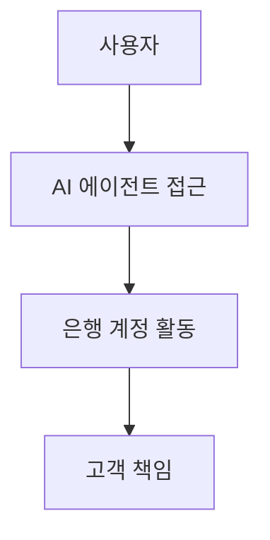
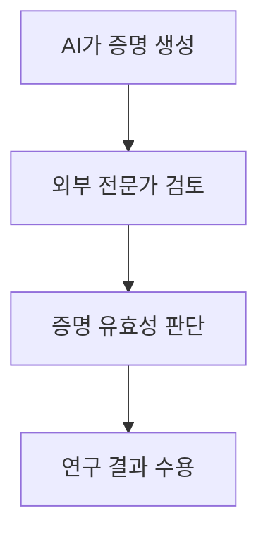
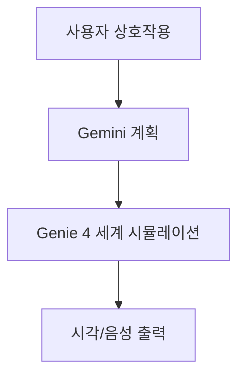

# Daily Report / 2026-10-28

> AI Agent / Agentic AI / LLM / Architecture / Framework / Pattern

- 수집: 2026-10-28 07:12 KST
- 범위: 수집 시각 기준 지난 24시간 / RSS 제목과 발췌문 기반
- 사실 요약과 해석은 출처 원문으로 재확인

## 1. AI 에이전트의 금융 접근, 사용자 책임과 보안 경계가 쟁점

- Bank of America는 AI 에이전트에 은행 비밀번호를 공유하지 말라고 고객에게 안내했다.
- 은행은 에이전트 접근으로 발생한 활동에 고객이 책임진다고 밝혔다.
- 해석: 에이전트가 계정에 접근할수록 인증정보 관리와 책임 범위가 실사용의 핵심 통제로 떠오른다.
- **의미:** 금융 계정에 AI 에이전트를 연결할 때 권한과 책임을 어떻게 제한할지가 중요해진다.
- **실행:** 에이전트 연결 전 금융기관의 자격증명 공유 지침과 계정 권한 설정을 확인한다.

**출처**

- [Bank of America kindly asks that you don’t share your banking password with your AI assistant](https://techcrunch.com/2026/10/27/bank-of-america-kindly-asks-that-you-dont-share-your-banking-password-with-your-ai-assistant/) / 10-28 06:44 KST

## 2. 생성 AI의 난제 풀이 주장, 외부 검증이 다음 관문

- OpenAI는 자사 모델이 수학, 컴퓨터과학, 물리학의 주요 미해결 문제 세 가지를 풀었다고 밝혔다.
- 노벨상 수상자를 포함한 외부 전문가들이 증명을 검토하고 있다.
- 해석: 성과의 신뢰도는 주장 자체보다 독립적인 증명 검토 결과에 달려 있다.
- **의미:** AI가 만든 연구 결과를 받아들이려면 재현 가능한 증명과 전문가 검증이 중요하다.
- **실행:** 외부 검토가 끝날 때까지 이를 확정된 과학적 돌파구로 인용하지 않는다.

**출처**

- [OpenAI asks outside experts, including a Nobel laureate, to check proofs its AI produced in math, computer science, and physics](https://the-decoder.com/openai-asks-outside-experts-including-a-nobel-laureate-to-check-proofs-its-ai-produced-in-math-computer-science-and-physics/) / 10-27 21:37 KST

## 3. Genie 4, 음성과 캐릭터가 있는 실시간 3D 세계 시뮬레이션 공개

- Google DeepMind는 상호작용 가능한 3D 세계를 음성, 대화하는 캐릭터와 함께 시뮬레이션하는 Genie 4를 소개했다.
- Gemini 모델이 배경에서 계획을 세워 시뮬레이션의 일관성을 유지하도록 돕는다.
- 기사에 따르면 초기 연구 모델이며, 세션이 길어지면 시각적 불일치가 나타난다.
- **의미:** 월드 모델이 실시간 상호작용을 다루는 연구 방향과 현재 한계를 함께 보여준다.
- **실행:** 긴 상호작용에서 일관성이 유지되는지 후속 연구 결과를 살펴본다.

**출처**

- [Google Deepmind's Genie 4 puts a modern spin on agent designs that predate LLMs](https://the-decoder.com/google-deepminds-genie-4-puts-a-modern-spin-on-agent-designs-that-predate-llms/) / 10-28 02:25 KST

## GitHub Trending / 수집 시점 스냅샷

- 지난 24시간 내 신규 발표를 뜻하지 않는다. 순위는 수집 시점에 따라 달라진다.

- [elayadesign/ai-design-skills](https://github.com/elayadesign/ai-design-skills)
- [nightly-labs/openbot](https://github.com/nightly-labs/openbot)
- [obra/superpowers](https://github.com/obra/superpowers)
- [pbakaus/impeccable](https://github.com/pbakaus/impeccable)
- [gitroomhq/postiz-app](https://github.com/gitroomhq/postiz-app)
