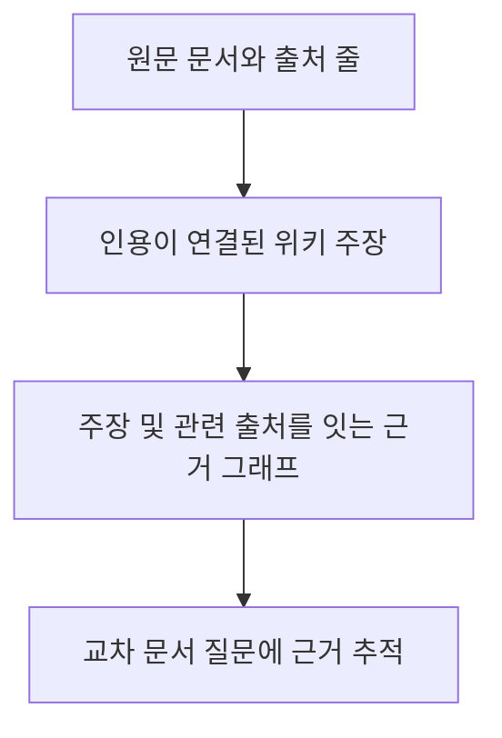
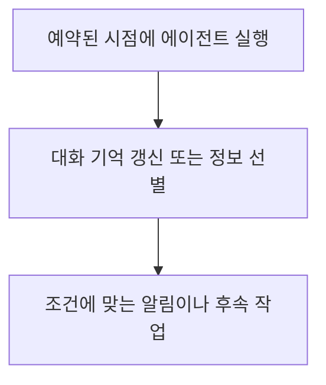
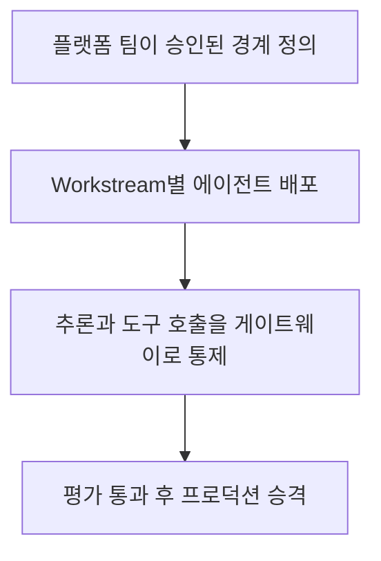

# 에이전트 기억/스케줄링에서 기업 운영 통제까지

> 수집: 2026-10-29 08:47 KST

> **오늘의 3줄 요약**
>
> - LangChain은 합성 보험 문서 111건에서 OpenWiki 기억층이 검색 도구만 쓴 에이전트보다 교차 문서 질문에 약 5배 정확했다고 보고했지만, 단순 조회에서는 기억층 없는 방식도 정확하고 빨랐다.
> - LangChain은 스케줄 실행이 자사 LangSmith의 Managed Deep Agents 실행 중 70% 이상이라고 밝혔고, 예약 작업으로 기억 갱신과 정보 선별 등을 구현하는 방식을 소개했다.
> - AWS는 Amazon Bedrock AgentCore 기반 기업 에이전트 청사진에 팀별 배포 경계와 추론/도구 게이트웨이, 배포 전 평가 관문을 포함했다. 실제 성능 결과는 제시하지 않았다.

> **오늘의 인사이트**
> 반복되는 여러 문서의 규칙을 다루는지, 정해진 주기로 먼저 움직여야 하는지부터 구분하고, 전자는 근거 추적과 비용, 후자는 실행 경계와 평가 관문을 함께 확인해야 한다.

## 1. 교차 문서 에이전트 기억에 근거 그래프를 더하다

- 무엇이 바뀜: LangChain은 OpenWiki로 문서 지식을 연결한 기억층을 만들고, 근거 그래프를 덧붙여 인용 근거와 관련 출처를 따라가게 했다.
- 기존 대비 차이: 발표한 합성 보험 문서 평가에서 위키 기억층은 검색 도구만 쓴 방식보다 교차 문서 질문 정확도가 약 5배였고, 근거 그래프는 위키만 쓴 경우보다 정확도를 27% 높이고 인용 일관성을 두 배로 높였다.

```report-panel
{
  "title": "기억층과 근거 그래프는 어떤 질문에서 차이를 냈나?",
  "metrics": [
    {
      "label": "평가 문서",
      "value": "111건",
      "detail": "LangChain이 만든 합성 보험 장문 문서 라이브러리"
    },
    {
      "label": "교차 문서 정확도",
      "value": "약 5배",
      "detail": "OpenWiki 위키 기억층과 검색 도구 단독 비교, 발표자 보고"
    },
    {
      "label": "근거 그래프 추가 효과",
      "value": "+27% 정확도, 인용 일관성 2배",
      "detail": "위키만 사용한 방식과 비교, 발표자 보고"
    }
  ],
  "comparisons": [
    {
      "label": "검색 도구 단독 → 위키 기억층",
      "before": "질문마다 관련 구절을 찾아 관계를 재구성",
      "after": "연결된 페이지의 도메인 지식을 재사용",
      "detail": "교차 출처 질문에서 위키 방식이 약 5배 정확했다고 발표"
    },
    {
      "label": "위키 기억층 → 근거 그래프 추가",
      "before": "위키 내용과 출처 인용",
      "after": "주장과 근거 구절, 관련 출처 사이의 명시적 연결",
      "detail": "정확도 27% 향상, 인용 일관성 2배라고 발표"
    }
  ],
  "findings": [
    {
      "label": "위키 기억층의 교차 문서 성능",
      "status": "reported",
      "evidence": "LangChain은 합성 보험 문서 평가에서 검색 도구 단독보다 약 5배 정확했다고 보고했다."
    },
    {
      "label": "근거 그래프 효과",
      "status": "reported",
      "evidence": "위키 단독 대비 정확도 27% 향상과 인용 일관성 2배를 보고했다."
    },
    {
      "label": "단순 조회 적용 한계",
      "status": "limited",
      "evidence": "원문은 기억층이 없는 에이전트도 단순 조회에서 같은 정확도를 내고 더 빨랐다고 밝혔다."
    }
  ],
  "chart": null,
  "conclusion": "반복되는 교차 문서 추론에는 출처 연결 기억층이 유리할 수 있지만, 단순 조회까지 적용할 이유는 평가 결과만으로 확인되지 않는다.",
  "sources": [
    {
      "title": "Building Evidence-Grounded Agent Memory with OpenWiki and Graphs",
      "url": "https://www.langchain.com/blog/building-agent-memory-openwiki-graphs"
    }
  ]
}
```

- **기술/산업 영향:** 해석: 정책/문서 사이의 수정과 참조를 반복해서 판단하는 업무라면 검색만으로 재구성할지, 출처 연결을 유지하는 기억층을 둘지 비용과 정확도를 함께 비교할 근거가 생겼다.
- **검증 행동:** 반복되는 문서 질문 하나를 골라 검색만 쓴 답과 위키 및 근거 그래프를 쓴 답의 정확도와 인용 출처를 대조한다.
- **한계:** LangChain의 자체 합성 보험 문서 111건 평가이며, 단순 조회에서는 기억층 없는 방식도 정확하고 빨랐다고 보고했다.

> 원문 근거로 재구성한 흐름도



**출처**

- [Building Evidence-Grounded Agent Memory with OpenWiki and Graphs](https://www.langchain.com/blog/building-agent-memory-openwiki-graphs) / 10-29 02:24 KST / 공식 원문 발췌

## 2. 예약 실행을 상시 에이전트의 기본 작동 방식으로 제시하다

- 무엇이 바뀜: LangChain은 cron 기반 예약 실행으로 대화 기억 갱신, 선제적 알림, 정보 선별, 에이전트 작업 조율을 구성하는 방식을 설명했다.
- 기존 대비 차이: 사용자가 매번 메시지를 입력해 시작하는 흐름과 달리, 일정에 따라 에이전트가 실행되어 먼저 작업을 시작한다.

```report-panel
{
  "title": "예약 실행은 에이전트의 어떤 동작을 바꾸나?",
  "metrics": [
    {
      "label": "예약 실행 비중",
      "value": "70% 초과",
      "detail": "LangSmith의 Managed Deep Agents 실행 중 비중이라는 LangChain 자체 보고"
    }
  ],
  "comparisons": [
    {
      "label": "사용자 입력 시작",
      "before": "사용자가 메시지를 보내면 에이전트가 실행",
      "after": "정해진 일정에 에이전트가 실행",
      "detail": "기억 갱신, 선제적 작업, 정보 선별, 후속 알림에 활용한다고 설명"
    }
  ],
  "findings": [
    {
      "label": "cron 기반 실행 구조",
      "status": "confirmed",
      "evidence": "LangChain은 예약 작업으로 일정에 따라 에이전트를 깨우는 구조와 용도를 설명했다."
    },
    {
      "label": "예약 실행 비중",
      "status": "reported",
      "evidence": "LangChain은 자사 Managed Deep Agents의 LangSmith 실행 중 70% 이상이 예약 실행이라고 밝혔다."
    },
    {
      "label": "범용 성과 해석",
      "status": "limited",
      "evidence": "제시된 비율은 자사 실행 구성에 관한 것으로, 응답 품질이나 다른 조직의 사용량을 측정하지 않는다."
    }
  ],
  "chart": null,
  "conclusion": "정기 실행이 필요한 기억 갱신과 모니터링에는 예약 방식이 맞지만, 제시된 사용 비중만으로 품질이나 보편적 채택을 판단할 수 없다.",
  "sources": [
    {
      "title": "Why aren’t you building proactive agents yet?",
      "url": "https://www.langchain.com/blog/proactive-agents"
    }
  ]
}
```

- **기술/산업 영향:** 해석: 주기 실행을 도입할 때는 모델 선택만이 아니라 실행 간격과 알림 기준, 장기 기억 갱신이 실제 업무 흐름에 필요한지 따져야 한다.
- **검증 행동:** 반복 알림 하나를 정해 실행 주기와 사용자에게 보낼 조건을 적고, 불필요한 실행이 생기는지 하루 동안 기록한다.
- **한계:** LangSmith 실행의 70% 초과가 예약 실행이라는 수치는 LangChain이 자사 서비스에서 보고한 값이며, 실행 품질이나 다른 조직의 비율을 뜻하지 않는다.

> 원문 근거로 재구성한 흐름도




원문 이미지: In Managed Deep Agents, schedules can be defined within the agent definition or can be created at runtime by calling the Schedules SDK with tools. / [출처 원문](https://www.langchain.com/blog/proactive-agents)

**출처**

- [Why aren’t you building proactive agents yet?](https://www.langchain.com/blog/proactive-agents) / 10-28 16:15 KST / 공식 원문 발췌

## 3. 기업 에이전트 배포를 팀별 경계와 평가 관문으로 묶다

- 무엇이 바뀜: AWS는 Amazon Bedrock AgentCore 청사진에 다중 계정 운영, Workstream별 배포, 추론/도구 게이트웨이, 프로덕션 승격 전 평가 파이프라인을 담았다.
- 기존 대비 차이: 팀마다 접근 통제와 운영 절차를 따로 조립하는 대신, 플랫폼 경계 안에서 팀별 실행과 비용 귀속, 평가/롤백을 관리하는 참조 구조를 제시했다.

```report-panel
{
  "title": "AWS 청사진은 팀별 에이전트 운영을 어디서 통제하나?",
  "metrics": [],
  "comparisons": [
    {
      "label": "팀별 개별 조립",
      "before": "각 팀이 접근 통제와 운영 장치를 구성",
      "after": "플랫폼 경계 안에서 Workstream별 배포",
      "detail": "AWS가 제시한 참조 구조에서 승인된 모델/도구, 소유권, 관측, 비용 귀속을 운영 계약에 포함"
    },
    {
      "label": "배포 직행",
      "before": "평가 관문이 명시되지 않은 승격",
      "after": "CI/CD 평가 파이프라인을 거쳐 프로덕션 승격",
      "detail": "평가를 배포 전 단계에 배치하는 참조 청사진"
    }
  ],
  "findings": [
    {
      "label": "분리된 추론/도구 게이트웨이",
      "status": "confirmed",
      "evidence": "AWS는 추론 게이트웨이와 인증된 MCP 도구 게이트웨이를 별도 구성요소로 설명했다."
    },
    {
      "label": "배포 전 평가 관문",
      "status": "confirmed",
      "evidence": "AWS는 각 에이전트를 프로덕션 승격 전에 평가하는 파이프라인을 청사진에 포함한다고 밝혔다."
    },
    {
      "label": "실제 효과",
      "status": "limited",
      "evidence": "게시물은 참조 아키텍처를 설명하지만, 보안/비용/성능의 실측 결과는 제공하지 않는다."
    }
  ],
  "chart": null,
  "conclusion": "팀별 자율 배포와 중앙 통제를 함께 설계하려는 조직에 참고 구조를 제공하지만, 효과는 실제 정책과 구현 검증에 달려 있다.",
  "sources": [
    {
      "title": "Building an Agentic AI Platform on Amazon Bedrock AgentCore | Amazon Web Services",
      "url": "https://aws.amazon.com/blogs/machine-learning/building-an-agentic-ai-platform-on-amazon-bedrock-agentcore/"
    }
  ]
}
```

- **기술/산업 영향:** 해석: 여러 팀이 에이전트를 운영할 때는 모델/도구 접근, 팀별 비용 귀속, 배포 전 평가가 한 운영 구조에서 연결되는지 확인해야 한다.
- **검증 행동:** 청사진에서 한 Workstream의 모델 접근, 도구 호출, 평가 통과 후 승격 경로를 따라가며 각 통제 지점을 표시한다.
- **한계:** AWS의 참조 청사진과 운영 원칙 설명이며, 실제 배포에서의 보안 효과나 성능 개선 수치는 제시되지 않았다.

> 원문 근거로 재구성한 흐름도



**출처**

- [Building an Agentic AI Platform on Amazon Bedrock AgentCore \| Amazon Web Services](https://aws.amazon.com/blogs/machine-learning/building-an-agentic-ai-platform-on-amazon-bedrock-agentcore/) / 10-29 03:28 KST / 공식 원문 발췌

## 오늘 살펴볼 인기 오픈소스

GitHub 일간 Trending 중 이전에 소개하지 않은 AI/개발 도구. 신규 출시를 뜻하지 않는다.

- [HKUDS/DeepTutor](https://github.com/HKUDS/DeepTutor)
  - 원문 설명: DeepTutor: Lifelong Personalized Tutoring. https://deeptutor.info/.
  - 한국어 요약: DeepTutor는 평생 개인화 튜터링을 제공하는 프로젝트다.
  - 확인할 점: 주제 ai-agents, ai-tutor, clawbot, cli-tool / 주 언어 Python
- [macro-inc/macro](https://github.com/macro-inc/macro)
  - 원문 설명: Macro is a unified workspace for teams: email, chat, docs, tasks, agents, calls, and CRM — @-linked together with shared AI memory.
  - 한국어 요약: Macro는 이메일, 채팅, 문서, 작업, 에이전트, 통화, CRM을 공유 AI 메모리로 연결하는 팀용 통합 워크스페이스다.
  - 확인할 점: 주제 agent, ai, ai-agents, all-in-one / 주 언어 Rust
- [expo/skills](https://github.com/expo/skills)
  - 원문 설명: A collection of AI agent skills for working with Expo projects and Expo Application Services
  - 한국어 요약: Expo 프로젝트와 Expo Application Services 작업을 위한 AI 에이전트 스킬 모음이다.
  - 확인할 점: 주 언어 Shell

## 출처 점검

| 출처 | 상태 | 확인한 글 | 최근 관련 글 | 검토 후보 |
| --- | --- | ---: | ---: | ---: |
| AWS Machine Learning | 수집 성공 | 20 | 2 | 2 |
| Anthropic Engineering | 확인 범위에 지난 24시간 관련 글 없음 | 8 | 0 | 0 |
| Anthropic News | 수집 성공 / 시각 미확인 2개 제외 | 8 | 1 | 1 |
| Anthropic Research | 확인 범위에 지난 24시간 관련 글 없음 | 8 | 0 | 0 |
| BleepingComputer | 수집 성공 | 15 | 2 | 0 |
| GitHub Trending | 수집 성공 | 14 | — | 3 |
| Google DeepMind | 일부 요청 실패 | 100 | 1 | 1 |
| Google News / AI Agent | 수집 성공 | 100 | 96 | 3 |
| Google News / AI and software vulnerabilities | 수집 성공 | 41 | 32 | 0 |
| Google News / Agent Architecture | 수집 성공 | 9 | 9 | 1 |
| Google News / Agent Framework | 수집 성공 | 9 | 9 | 1 |
| Google News / Agent development infrastructure | 수집 성공 | 7 | 6 | 3 |
| Google News / Agent pattern | 확인 범위에 지난 24시간 관련 글 없음 | 0 | 0 | 0 |
| Google News / Agentic AI | 수집 성공 | 100 | 97 | 3 |
| Google News / Compute and space infrastructure | 수집 성공 | 100 | 98 | 1 |
| Google News / Inference evaluation and model research | 수집 성공 | 51 | 38 | 0 |
| Google News / LLM | 수집 성공 | 28 | 28 | 0 |
| Google News / Personal agents and market structure | 수집 성공 | 18 | 12 | 0 |
| Google News / Robotics and autonomy | 수집 성공 | 100 | 95 | 1 |
| Google News / Tech mergers | 수집 성공 | 60 | 40 | 2 |
| Google News / Training algorithms and efficiency | 확인 범위에 지난 24시간 관련 글 없음 | 51 | 0 | 0 |
| Google News KR / AI industry and economics | 수집 성공 | 100 | 88 | 0 |
| Google News KR / AI research and engineering | 수집 성공 | 100 | 84 | 0 |
| Google Research | 확인 범위에 지난 24시간 관련 글 없음 | 100 | 0 | 0 |
| Hugging Face | 확인 범위에 지난 24시간 관련 글 없음 | 891 | 0 | 0 |
| LangChain Blog | 수집 성공 | 8 | 2 | 2 |
| MIT Technology Review AI | 수집 성공 | 10 | 2 | 0 |
| Microsoft Research | 확인 범위에 지난 24시간 관련 글 없음 | 10 | 0 | 0 |
| NVIDIA Developer | 확인 범위에 지난 24시간 관련 글 없음 | 100 | 0 | 0 |
| OpenAI News | 일부 요청 실패 | 1334 | 3 | 3 |
| TechCrunch AI | 수집 성공 | 20 | 10 | 0 |
| The Decoder | 수집 성공 | 10 | 6 | 0 |
| The Register | 수집 성공 | 50 | 8 | 0 |
