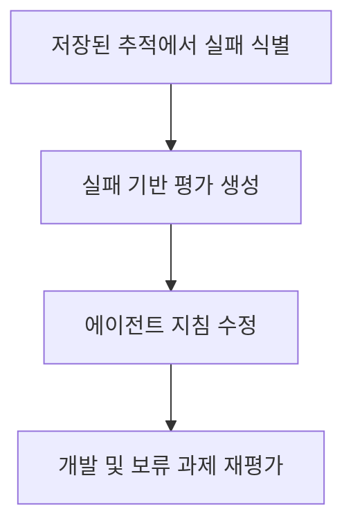
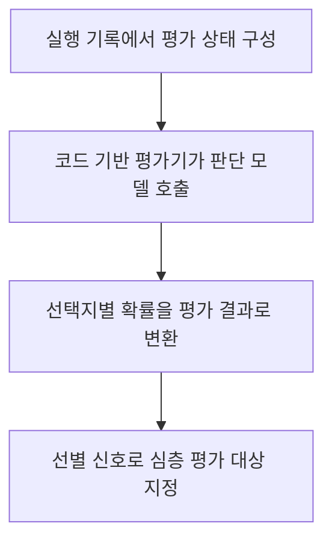
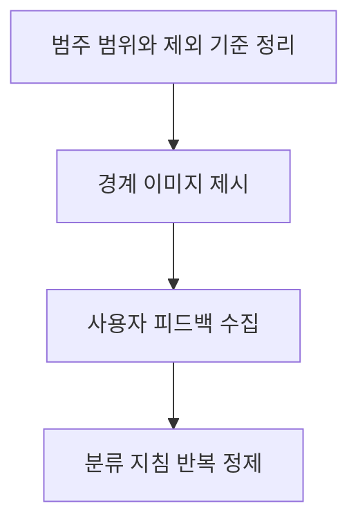

# 에이전트 운영은 추적/평가로, 공장 업무는 전문 에이전트로

> 수집: 2026-11-05 14:53 KST

> **오늘의 3줄 요약**
>
> - NVIDIA NeMo는 저장된 에이전트 추적에서 실패를 찾아 평가를 다시 돌리는 최적화 절차를 제시했고, Dassault 예시에서는 6개 시나리오에서 잘못된 도구 호출을 142회에서 0회로 줄였다고 발표했다.
> - AWS Deep Insight는 스크립트 실행 도구와 필요 시점에 불러오는 기술로 참조 구현의 컨텍스트 추가 토큰과 시스템 프롬프트를 각각 약 95%, 97% 줄였다고 보고했다.
> - Google Research의 Agile Deliberation은 18회의 사용자 세션에서 주관적 이미지 분류 기준을 대화로 다듬는 방식을 평가했으며, Amazon Quick은 정책상 허용된 일부 작업만 자동 검토 대상으로 삼고 중요 작업은 사람 승인에 남긴다.

> **오늘의 인사이트**
> 에이전트 도입을 판단할 때는 데모의 자동화율보다 실제 업무에서 추적과 독립 평가가 가능한지, 자동 승인 경계와 작업자 검토 조건이 어떻게 정해졌는지 확인해야 한다.

## 1. 에이전트 개선을 추적에서 재현 가능한 평가로 연결

- 무엇이 바뀜: NVIDIA NeMo는 저장된 실행 추적에서 반복 실패를 찾고, 맞춤 평가를 만든 뒤 개발 및 보류 과제로 수정 효과와 회귀를 확인하는 절차를 제시했다.
- 기존 대비 차이: 일반 벤치마크 점수만 보는 대신, 실제 추적에서 찾은 도구 호출 오류를 도메인 평가로 다시 측정한다.

```report-panel
{
  "title": "추적에서 찾은 수정이 보류 과제에서도 통하는가?",
  "metrics": [
    {
      "label": "잘못된 도구 호출",
      "value": "142회에서 0회",
      "detail": "Dassault Systèmes 엔지니어링 예시에서 보고된 변경"
    },
    {
      "label": "전체 평가 점수",
      "value": "상대 28% 개선",
      "detail": "같은 예시의 6개 시나리오에서 발표자가 보고"
    },
    {
      "label": "실행당 도구 호출",
      "value": "35% 감소",
      "detail": "같은 예시에서 발표자가 보고"
    }
  ],
  "comparisons": [
    {
      "label": "수정 전후",
      "before": "잘못된 도구 호출 142회",
      "after": "0회",
      "detail": "해당 예시의 평가 결과이며 다른 업무로 일반화할 근거는 제공되지 않음"
    }
  ],
  "findings": [
    {
      "label": "실행 추적에 연결된 평가 반복 절차",
      "status": "confirmed",
      "evidence": "NeMo Compass가 추적과 평가 증거를 분석하고, NeMo Eval Author로 평가를 만든 뒤 개발 및 보류 과제에 재실행하는 절차를 원문이 설명한다."
    },
    {
      "label": "수치 성능 개선",
      "status": "reported",
      "evidence": "NVIDIA는 Dassault 예시에서 6개 시나리오 결과를 보고했으며 독립 검증 자료는 제시하지 않았다."
    }
  ],
  "chart": null,
  "conclusion": "실패 추적과 보류 과제 평가를 함께 운영할 때 수정 효과와 회귀를 확인하는 절차로 활용할 수 있다. 발표된 개선 수치는 해당 6개 시나리오에 한정된다.",
  "sources": [
    {
      "title": "Use NVIDIA NeMo to Turn Agent Failures into Tests and Harness Fixes",
      "url": "https://developer.nvidia.com/blog/use-nvidia-nemo-to-turn-agent-failures-into-tests-and-harness-fixes/"
    }
  ]
}
```

- **기술/산업 영향:** 해석: 에이전트 수정안을 채택할 때 추적에서 확인된 실패가 평가 과제에 반영됐는지, 보류 과제에서도 개선이 유지되는지를 기준으로 삼을 수 있다.
- **검증 행동:** 보유한 에이전트 실행 기록 하나를 골라 반복되는 도구 호출 오류를 표시하고, 같은 조건을 확인하는 평가 항목 하나를 작성한다.
- **한계:** Dassault 예시의 수치는 NVIDIA가 6개 시나리오에서 보고한 결과이며 독립 검증 여부는 제시되지 않았다.

> 원문 근거로 재구성한 흐름도




원문 이미지: A glowing network cube connected by green arrows to a developer, code blocks, a checklist, and a rising bar chart. / [출처 원문](https://developer.nvidia.com/blog/use-nvidia-nemo-to-turn-agent-failures-into-tests-and-harness-fixes/)

**출처**

- [Use NVIDIA NeMo to Turn Agent Failures into Tests and Harness Fixes](https://developer.nvidia.com/blog/use-nvidia-nemo-to-turn-agent-failures-into-tests-and-harness-fixes/) / 11-05 01:00 KST / 공식 원문 발췌

## 2. 에이전트 평가에 고정 선택지와 확률 점수를 도입

- 무엇이 바뀜: AWS는 Amazon Bedrock AgentCore Evaluations의 코드 기반 평가기에 고정 선택지의 판단 모델을 연결해 라벨과 확률 점수를 반환하는 방법을 공개했다.
- 기존 대비 차이: 자유 형식 설명을 만드는 대규모 언어 모델 심판과 달리, 판단 모델은 사전에 정한 선택지의 확률을 내고 이후 심층 평가 대상을 고르는 선별층으로 쓸 수 있다.

```report-panel
{
  "title": "고정 선택지 판단 모델은 평가의 어느 단계에 맞는가?",
  "metrics": [],
  "comparisons": [
    {
      "label": "평가 결과 형식",
      "before": "일반 대규모 언어 모델 심판은 점수와 설명을 생성",
      "after": "판단 모델은 사전 정의 답변별 확률 분포를 반환",
      "detail": "AWS는 이를 임계값 기반 선별에 사용할 수 있다고 설명"
    }
  ],
  "findings": [
    {
      "label": "AgentCore에서 코드 기반 평가기와 판단 모델 연결",
      "status": "confirmed",
      "evidence": "AWS 원문은 평가 입력을 판단 모델 요청으로 바꾸고 확률을 AgentCore 평가 결과로 매핑하는 구현을 설명한다."
    },
    {
      "label": "자체 트래픽 검증 전 임계값 운영",
      "status": "limited",
      "evidence": "AWS는 실제 트래픽에서 질문을 검증한 뒤 점수로 사용하라고 안내하며 정확도나 임계값 수치는 제공하지 않는다."
    }
  ],
  "chart": null,
  "conclusion": "답의 범위가 고정된 반복 평가에서 선별층으로 고려할 수 있으며, 실제 트래픽에서 질문과 점수 기준을 먼저 검증해야 한다.",
  "sources": [
    {
      "title": "Use decision models with Amazon Bedrock AgentCore Evaluations | Amazon Web Services",
      "url": "https://aws.amazon.com/blogs/machine-learning/use-decision-models-with-amazon-bedrock-agentcore-evaluations/"
    }
  ]
}
```

- **기술/산업 영향:** 해석: 정책 준수나 도구 호출 안전처럼 답이 정해진 항목은 먼저 확률 임계값으로 선별하고, 설명이 필요한 사례는 기존 평가기로 넘기는 구성을 검토할 수 있다.
- **검증 행동:** 에이전트 로그에서 정답 선택지가 고정된 질문 하나를 골라 판단 모델 결과와 사람 판정을 나란히 기록한다.
- **한계:** AWS는 자체 트래픽에서 질문을 검증한 뒤 사용하라고 명시하며, 임계값과 정확도 수치는 이 발췌에 제시되지 않았다.

> 원문 근거로 재구성한 흐름도




원문 이미지: The evaluation pipeline that evaluate.py deploys, combining deterministic, built-in, and decision-model evaluators across on-demand and online modes / [출처 원문](https://aws.amazon.com/blogs/machine-learning/use-decision-models-with-amazon-bedrock-agentcore-evaluations/)


원문 이미지: The code-based evaluator Lambda converting OpenTelemetry spans into a decision-model request and mapping the probabilities back to an AgentCore result / [출처 원문](https://aws.amazon.com/blogs/machine-learning/use-decision-models-with-amazon-bedrock-agentcore-evaluations/)

**출처**

- [Use decision models with Amazon Bedrock AgentCore Evaluations \| Amazon Web Services](https://aws.amazon.com/blogs/machine-learning/use-decision-models-with-amazon-bedrock-agentcore-evaluations/) / 11-05 03:46 KST / 공식 원문 발췌

## 3. 주관적 분류 기준을 사용자와 함께 다듬는 연구

- 무엇이 바뀜: Google Research의 Agile Deliberation은 이미지 사례와 경계 사례에 대한 사용자 피드백을 받아 주관적 분류 개념과 분류기 지침을 반복 조정하는 프레임워크를 발표했다.
- 기존 대비 차이: 처음부터 고정 라벨을 요구하는 방식 대신, 범주 범위를 정하고 애매한 사례를 검토하며 정의를 구체화한다.

```report-panel
{
  "title": "사용자가 아직 정의하지 못한 범주를 어떻게 명료화하는가?",
  "metrics": [
    {
      "label": "사용자 평가",
      "value": "18회",
      "detail": "각 세션 1.5시간, Google Research가 밝힌 라이브 사용자 평가"
    }
  ],
  "comparisons": [
    {
      "label": "정의 방식",
      "before": "고정된 범주 정의로 라벨링 시작",
      "after": "범위 설정과 경계 사례 피드백으로 정의를 반복 조정",
      "detail": "이미지 분류를 위한 Agile Deliberation의 두 단계 접근"
    }
  ],
  "findings": [
    {
      "label": "범위 설정과 경계 사례 반복을 포함한 워크플로",
      "status": "confirmed",
      "evidence": "Google Research 원문은 concept scoping 및 concept iteration 단계와 경계 이미지 피드백을 설명한다."
    },
    {
      "label": "피로 감소와 분류 성능 향상",
      "status": "reported",
      "evidence": "연구진은 라이브 세션에서 수동 프롬프트 작성 대비 피로와 불안을 줄이고 더 일관되고 높은 성능의 모델을 얻었다고 보고했다."
    },
    {
      "label": "다른 주관적 분류 과제로의 일반화",
      "status": "uncertain",
      "evidence": "제공된 본문은 사용자 세션 평가를 설명하지만 다양한 업무 조건에 대한 수치 비교는 제공하지 않는다."
    }
  ],
  "chart": null,
  "conclusion": "범주의 경계가 고정되지 않은 이미지 분류에서 정의를 사용자와 함께 정제하는 접근이다. 적용 효과는 대상 사용자와 분류 업무에서 별도로 확인해야 한다.",
  "sources": [
    {
      "title": "Agile Deliberation: How AI helps humans define the gray areas",
      "url": "https://research.google/blog/agile-deliberation-how-ai-helps-humans-define-the-gray-areas/"
    }
  ]
}
```

- **기술/산업 영향:** 해석: 건강식이나 콘텐츠 조정처럼 범주 경계가 사람마다 달라질 수 있는 분류에서는 라벨 수집 전에 사용자가 경계 사례를 어떻게 판단하는지 합의하는 절차를 검토할 수 있다.
- **검증 행동:** 팀의 주관적 이미지 분류 항목 하나를 정해 포함 사례와 제외 사례를 각각 기록하고 경계 사례를 모은다.
- **한계:** Google Research는 18회의 1.5시간 사용자 세션에서 평가했다고 밝혔지만, 이 자료만으로 다른 분류 업무의 성능 개선 폭을 판단할 수 없다.

> 원문 근거로 재구성한 흐름도




원문 이미지: Flowchart illustrating a multi-stage AI concept scoping and refinement workflow for image classification. / [출처 원문](https://research.google/blog/agile-deliberation-how-ai-helps-humans-define-the-gray-areas/)

**출처**

- [Agile Deliberation: How AI helps humans define the gray areas](https://research.google/blog/agile-deliberation-how-ai-helps-humans-define-the-gray-areas/) / 11-05 03:07 KST / 공식 원문 발췌

## 오늘 살펴볼 인기 오픈소스

GitHub 일간 Trending 중 이전에 소개하지 않은 AI/개발 도구. 신규 출시를 뜻하지 않는다.

- [thedotmack/claude-mem](https://github.com/thedotmack/claude-mem)
  - 원문 설명: Persistent Context Across Sessions for Every Agent – Captures everything your agent does during sessions, compresses it with AI, and injects relevant context back into future sessions. Works with Claude Code, OpenClaw, Codex, Gemini, Hermes, Copilot, OpenCode + More
  - 한국어 요약: 세션에서 에이전트의 작업을 기록하고 AI로 압축해 관련 맥락을 이후 세션에 제공한다.
  - 확인할 점: 주제 ai, ai-agents, ai-memory, anthropic / 주 언어 TypeScript
- [vercel-labs/agent-desktop](https://github.com/vercel-labs/agent-desktop)
  - 원문 설명: Computer use CLI for AI agents
  - 한국어 요약: AI 에이전트를 위한 컴퓨터 사용 CLI다.
  - 확인할 점: 주제 accessibility, accessibility-api, ai-agents, automation / 주 언어 Rust
- [The-PR-Agent/pr-agent](https://github.com/The-PR-Agent/pr-agent)
  - 원문 설명: 🚀 PR Agent: The Original Open-Source PR Reviewer. This project is not the Qodo free tier.
  - 한국어 요약: 오픈소스 PR 검토 에이전트다.
  - 확인할 점: 주제 ai, anthropic, code-review, coding-assistant / 주 언어 Python
- [FareedKhan-dev/kimi-k3-in-c](https://github.com/FareedKhan-dev/kimi-k3-in-c)
  - 원문 설명: A 2.78-trillion-parameter Kimi K3 running inference on a single CPU in 8.24 GB of RAM. Portable C99: no BLAS, no framework, no GPU.
  - 한국어 요약: 단일 CPU와 8.24GB RAM에서 Kimi K3 추론을 실행하는 이식형 C99 구현이라고 설명한다.
  - 확인할 점: 주제 avx2, c99, cpu-inference, deep-learning / 주 언어 C
- [NVIDIA/auto-ontology](https://github.com/NVIDIA/auto-ontology)
  - 원문 설명: Auto Ontology is a Python framework for building semantic, graph-based reasoning layers over data. It enables deterministic query generation, better context retrieval, and more explainable AI for LLM and agent workflows.
  - 한국어 요약: 데이터 위에 의미 기반 그래프 추론 계층을 구축하는 Python 프레임워크다.
  - 확인할 점: 주 언어 Python

## 출처 점검

| 출처 | 상태 | 확인한 글 | 최근 관련 글 | 검토 후보 |
| --- | --- | ---: | ---: | ---: |
| AWS Machine Learning | 수집 성공 | 20 | 5 | 3 |
| Anthropic Engineering | 확인 범위에 지난 24시간 관련 글 없음 | 8 | 0 | 0 |
| Anthropic News | 확인 범위에 지난 24시간 관련 글 없음 / 시각 미확인 2개 제외 | 8 | 0 | 0 |
| Anthropic Research | 확인 범위에 지난 24시간 관련 글 없음 | 8 | 0 | 0 |
| BleepingComputer | 수집 성공 | 15 | 1 | 0 |
| GitHub Trending | 수집 성공 | 16 | — | 5 |
| Google DeepMind | 확인 범위에 지난 24시간 관련 글 없음 | 100 | 0 | 0 |
| Google News / AI Agent | 수집 성공 | 100 | 100 | 3 |
| Google News / AI and software vulnerabilities | 수집 성공 | 14 | 13 | 1 |
| Google News / Agent Architecture | 수집 성공 | 8 | 8 | 0 |
| Google News / Agent Framework | 수집 성공 | 9 | 8 | 1 |
| Google News / Agent development infrastructure | 수집 성공 | 13 | 12 | 3 |
| Google News / Agent pattern | 확인 범위에 지난 24시간 관련 글 없음 | 0 | 0 | 0 |
| Google News / Agentic AI | 수집 성공 | 100 | 96 | 2 |
| Google News / Compute and space infrastructure | 수집 성공 | 100 | 99 | 0 |
| Google News / Inference evaluation and model research | 수집 성공 | 26 | 18 | 1 |
| Google News / LLM | 수집 성공 | 31 | 28 | 1 |
| Google News / Personal agents and market structure | 수집 성공 | 24 | 22 | 0 |
| Google News / Robotics and autonomy | 수집 성공 | 100 | 95 | 0 |
| Google News / Tech mergers | 수집 성공 | 63 | 45 | 2 |
| Google News / Training algorithms and efficiency | 확인 범위에 지난 24시간 관련 글 없음 | 10 | 0 | 0 |
| Google News KR / AI industry and economics | 수집 성공 | 100 | 82 | 0 |
| Google News KR / AI research and engineering | 수집 성공 | 87 | 74 | 1 |
| Google Research | 수집 성공 | 100 | 1 | 1 |
| Hugging Face | 확인 범위에 지난 24시간 관련 글 없음 | 897 | 0 | 0 |
| LangChain Blog | 확인 범위에 지난 24시간 관련 글 없음 | 8 | 0 | 0 |
| MIT Technology Review AI | 수집 성공 | 10 | 2 | 0 |
| Microsoft Research | 확인 범위에 지난 24시간 관련 글 없음 | 10 | 0 | 0 |
| NVIDIA Developer | 수집 성공 | 100 | 3 | 3 |
| OpenAI News | 수집 성공 | 1359 | 3 | 1 |
| TechCrunch AI | 수집 성공 | 20 | 12 | 0 |
| The Decoder | 수집 성공 | 10 | 8 | 1 |
| The Register | 수집 성공 | 50 | 6 | 0 |
